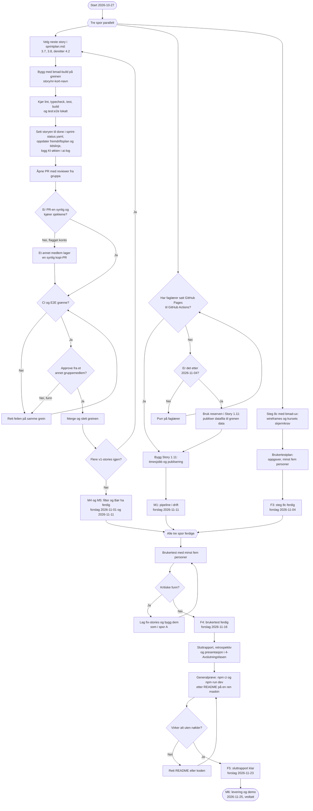

# Aktivitetsdiagram fram til levering

Arbeidsflyten gruppa følger fra i dag (2026-10-27) til levering og demo 2026-11-25. Diagrammet
viser rekkefølgen og reglene, ikke status. Status står i
[fremdriftsplanen](fremdriftsplan.md), og datoene i [milepælene](../2-Planleggingsfasen/milepæler.md)
og [tidslinjen](fremdriftsplan.md#tidslinje). Fristene merket «forslag» er ikke vedtatt ennå.

Tre spor går parallelt: storyene som gjenstår, Story 1.11 (som venter på faglærer) og steg 8c
med brukertestplanen. Når alle tre er ferdige, går vi videre til brukertest, sluttrapport og
levering.

## Løpende hele perioden

- **Gruppemøte hver uke:** skriv referat i [`møtereferater/`](møtereferater/). Vedtatte frister
  føres inn i milepælene, og «forslag» byttes med «vedtatt».
- **Når en frist ikke holder:** flytt den i milepælene og tidslinjen i samme PR, og si hvorfor i
  «Hvor er vi nå?» i fremdriftsplanen. Nye krav eller mer omfang går gjennom `bmad-correct-course`.
- **Kontoene til Kelly og Sena:** til GitHub Support har sluppet dem fri, lager et annet medlem
  synlige kopi-PR-er av arbeidet deres (se spor A).

Diagrammet oppdateres når arbeidsflyten endres, for eksempel når et spor er ferdig, når en story
legges til eller tas ut, eller når en regel i `AGENTS.md` endrer hvordan vi leverer.
