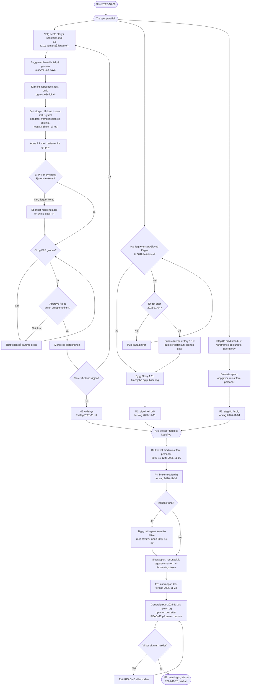
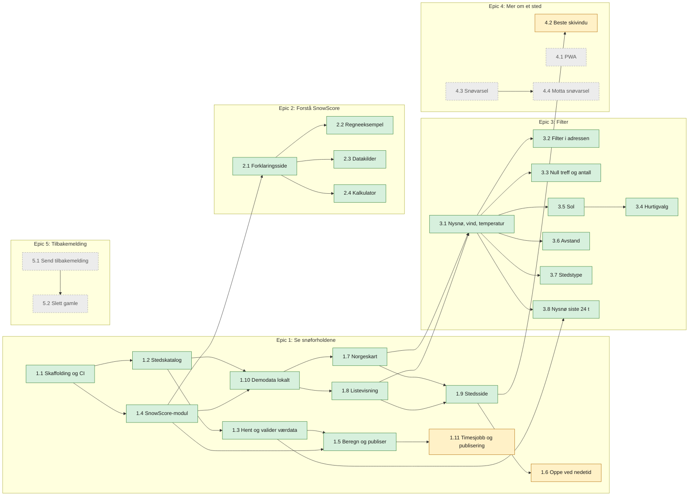

# Aktivitetsdiagram og aktivitetsliste

Arbeidsflyten gruppa følger fra i dag (2026-10-28) til levering og demo 2026-11-25, og en liste
over alle aktivitetene i prosjektet, bygget fra [epics og stories](../2-Planleggingsfasen/SnowFinder-Epics-og-Stories.md)
og [sprintplanen](../2-Planleggingsfasen/sprintplan.md). Status for hver story står i
[fremdriftsplanen](fremdriftsplan.md), og datoene i [milepælene](../2-Planleggingsfasen/milepæler.md)
og [tidslinjen](fremdriftsplan.md#tidslinje). Fristene merket «forslag» er ikke vedtatt ennå.

## Arbeidsflyt fram til levering

Tre spor går parallelt: storyene som gjenstår, Story 1.11 (som venter på faglærer) og steg 8c
med brukertestplanen. Når alle tre er ferdige og koden er fryst, går vi videre til brukertest,
rettinger, sluttrapport og levering.

### Løpende hele perioden

- **Gruppemøte hver uke:** skriv referat i [`møtereferater/`](møtereferater/). Vedtatte frister
  føres inn i milepælene, og «forslag» byttes med «vedtatt».
- **Når en frist ikke holder:** flytt den i milepælene og tidslinjen i samme PR, og si hvorfor i
  «Hvor er vi nå?» i fremdriftsplanen. Nye krav eller mer omfang går gjennom `bmad-correct-course`.
- **Etter kodefrys (2026-11-11):** bare rettinger fra brukertesten bygges. Alt annet skrives inn i
  sluttrapporten som videre arbeid.
- **Kontoene til Kelly og Sena:** til GitHub Support har sluppet dem fri, lager et annet medlem
  synlige kopi-PR-er av arbeidet deres (se spor A).

## Aktivitetsliste

Alle aktivitetene i prosjektet: én rad per story fra epics-dokumentet, pluss arbeidet som ikke er
en story (planlegging, brukertest, rapport og levering). «Avhenger av» er det som må være ferdig
før aktiviteten kan starte. Ferdige aktiviteter har datoen PR-en ble merget, og de andre har
fristen fra milepælene.

### Avhengigheter mellom storyene

Grønn er ferdig, gul gjenstår i v1, og grå med stiplet kant er «Ikke i v1».

### Stories

| ID | Aktivitet | Prioritet | Avhenger av | Sprint | Ansvarlig | Ferdig eller frist |
|---|---|---|---|---|---|---|
| **Epic 1** | **Se snøforholdene i Norge, på kart eller i liste** | | | | | |
| 1.1 | Prosjekt-skaffolding og CI-skjelett | Må ha | – | 1 | Aksel og Joseph | 2026-10-07 (PR #7, #10) |
| 1.2 | Bygg stedskatalogen | Må ha | 1.1 | 1 | Aksel | 2026-10-07 (PR #18) |
| 1.4 | Bygg den delte SnowScore-modulen | Må ha | 1.1 | 1 | Aksel | 2026-10-07 (PR #20) |
| 1.10 | Kjør SnowFinder lokalt med demodata | Må ha | 1.2, 1.4 | 1 | Aksel | 2026-10-07 (PR #22) |
| 1.3 | Hent og valider værdata hver time | Må ha | 1.2 | 2 | Aksel | 2026-10-08 (PR #23) |
| 1.5 | Beregn og publiser SnowScore i dataprogrammet | Må ha | 1.3, 1.4 | 2 | Aksel | 2026-10-08 (PR #24) |
| 1.7 | Se Norgeskartet med fargelagte steder (med 1.7b) | Må ha | 1.10 | 2 | Aksel | 2026-10-08 (PR #25, #28) |
| 1.8 | Bruk tilgjengelig listevisning i stedet for kart | Må ha | 1.10 | 2 | Aksel | 2026-10-08 (PR #27) |
| 1.9 | Åpne en stedsside med full poengsum (med 1.9b og 1.9c) | Må ha | 1.7, 1.8 | 2 | Aksel | 2026-10-08 (PR #30–#32) |
| 1.11 | Kjør dataprogrammet hver time og publiser appen | Må ha | 1.5, GitHub Pages fra faglærer (ellers reserven) | 2, flyttet til 4 | Fordeles på møtet | 2026-11-11, forslag |
| 1.6 | Hold tjenesten oppe når en datakilde er nede | Bør ha | 1.9 | 4 | Fordeles på møtet | 2026-11-11, forslag |
| **Epic 2** | **Forstå og stole på SnowScore** | | | | | |
| 2.1 | Les kort fortalt og steg for steg | Må ha | 1.4 | 1 | Aksel | 2026-10-09 (PR #33) |
| 2.2 | Se det utledede regneeksempelet | Må ha | 2.1 | 1 | Aksel | 2026-10-09 (PR #34) |
| 2.3 | Les om datakilder og begrensninger | Må ha | 2.1 | 1 | Aksel | 2026-10-09 (PR #35) |
| 2.4 | Prøv SnowScore-kalkulatoren selv | Bør ha | 2.1 | 1 | Aksel | 2026-10-09 (PR #36) |
| – | Retrospektiv for Epic 2 og tiltak A1–A5, A11 | – | 2.1–2.4 | 1 | Aksel | 2026-10-09 (PR #37, #38) |
| **Epic 3** | **Finn steder som oppfyller mine krav** | | | | | |
| 3.1 | Filtrer på nysnø, vind og temperatur | Må ha | 1.7, 1.8 | 3 | Aksel | 2026-10-22 (PR #48) |
| 3.2 | Del og gjenåpne et filtrert søk (med 3.2b) | Må ha | 3.1 | 3 | Aksel | 2026-10-23 (PR #49, #50) |
| 3.3 | Få hjelp ved null treff og se antall treff live | Må ha | 3.1 | 3 | Aksel | 2026-10-23 (PR #52) |
| 3.5 | Filtrer på sol | Bør ha | 3.1 | 3 | Aksel | 2026-10-23 (PR #53) |
| 3.4 | Bruk hurtigvalg for vanlige kombinasjoner | Bør ha | 3.5 | 3 | Kelly | 2026-10-25 (PR #57) |
| 3.6 | Filtrer på avstand | Bør ha | 3.1 | 3 | Kelly | 2026-10-27 (PR #63) |
| 3.7 | Filtrer på stedstype | Bør ha | 3.1 | 3 | Sena | 2026-10-28 (PR #66) |
| 3.8 | Filtrer på nysnø siste 24 timer | Bør ha | 3.1, 1.3 | 3 | Sena | 2026-10-28 (PR #71) |
| – | Retrospektiv for Epic 3 (valgfri) | – | 3.1–3.8 | 4 | Fordeles på møtet | 2026-11-03, forslag |
| **Epic 4** | **Få mer ut av et sted jeg følger med på** | | | | | |
| 4.2 | Se beste skivindu på stedssiden | Bør ha | 1.9 | 4 | Aksel | 2026-10-28 (bygget, venter på review) |
| 4.1 | Gjør SnowFinder installerbar som PWA | Ikke i v1 | – | – | – | – |
| 4.3 | Registrer et snøvarsel uten konto | Ikke i v1 | – | – | – | – |
| 4.4 | Motta og meld deg av et snøvarsel | Ikke i v1 | 4.3 | – | – | – |
| **Epic 5** | **Gi tilbakemelding uten konto (Ikke i v1)** | | | | | |
| 5.1 | Send en tilbakemelding uten konto | Ikke i v1 | – | – | – | – |
| 5.2 | Automatisk sletting av gamle tilbakemeldinger | Ikke i v1 | 5.1 | – | – | – |

### Andre aktiviteter

| ID | Aktivitet | Fase | Avhenger av | Ansvarlig | Ferdig eller frist |
|---|---|---|---|---|---|
| P1 | Produktbrief (steg 1) | Oppstart | – | Hele gruppa | 2026-09-22 (F1) |
| P2 | PRD, arkitektur, UX, epics og stories (steg 2–7) | Planlegging | P1 | Hele gruppa | 2026-09-27 |
| P3 | Sprintplan (steg 8) | Planlegging | P2 | Hele gruppa | 2026-10-03 (PR #6) |
| P4 | Forenkling etter faglærers tilbakemelding (steg 8b og 8d) | Planlegging | P3 | Joseph og Aksel | 2026-10-07 (F2, PR #8–#21) |
| P5 | Revisjon og rettinger i dataprogrammet | Gjennomføring | Epic 1 og 2 | Aksel | 2026-10-22 (PR #43–#47) |
| P6 | Wireframes, kursets skjermkrav og brukertestplan (steg 8c, `bmad-ux`) | Planlegging | P4 | Fordeles på møtet | 2026-11-04, forslag (F3) |
| P7 | Kodefrys: alle v1-stories merget | Gjennomføring | 1.6, 1.11, 4.2 | Hele gruppa | 2026-11-11, forslag (M1 og M5) |
| P8 | Brukertest med minst fem personer | Gjennomføring | P6, P7 | Fordeles på møtet | 2026-11-16, forslag (F4) |
| P9 | Rettinger etter brukertesten (bare kritiske funn) | Gjennomføring | P8 | Fordeles etter testen | 2026-11-20, forslag |
| P10 | Sluttrapport, retrospektiv og presentasjon | Avslutning | P8 | Hele gruppa | 2026-11-23, forslag (F5) |
| P11 | Generalprøve: `npm ci && npm run dev` etter README på en ren maskin | Avslutning | P9, P10 | Fordeles på møtet | 2026-11-24, forslag |
| P12 | Levering og demo | Avslutning | P11 | Hele gruppa | 2026-11-25, vedtatt (M6) |

Diagrammene og listen oppdateres når arbeidsflyten endres, for eksempel når et spor er ferdig, når
en story legges til eller tas ut, når en frist flyttes, eller når en regel i `AGENTS.md` endrer
hvordan vi leverer.
