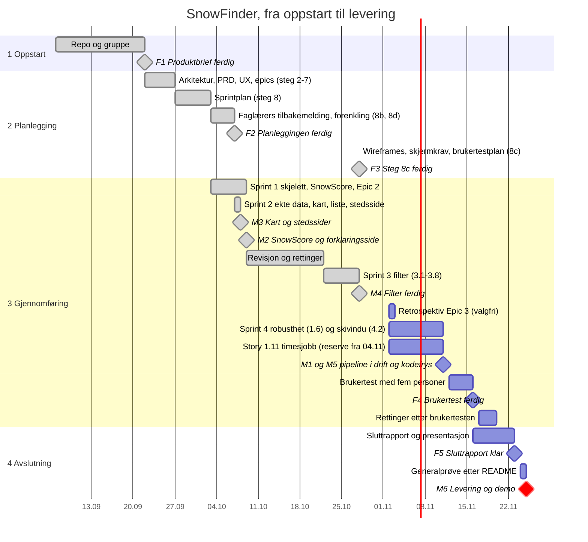

# Fremdriftsplan

Oversikt over hvordan vi går fram, steg for steg, så alle kan følge med selv om de ikke var
på møtet. Oppdater statusen når et steg er ferdig.

**Sist oppdatert:** 2026-10-28

## Slik holder du deg oppdatert

1. Se **Hvor er vi nå?** under.
2. Se [tidslinjen](#tidslinje) og [milepælene](../2-Planleggingsfasen/milepæler.md) for datoene,
   og [aktivitetsdiagrammet](aktivitetsdiagram.md) for arbeidsflyten fram til levering.
3. Les siste referat i [`møtereferater/`](møtereferater/).
4. Se promptene fra siste økt i [`ai-log/prompter/`](../../ai-log/prompter/).

## Hvor er vi nå?

**28. oktober (kveld): Steg 8c ferdig, en uke før forslaget.**

- Aksel kjørte steg 8c med Sally (`bmad-ux`). Wireframes for Utforsk, stedssiden og
  forklaringssiden på mobil og desktop ligger i [wireframes/](../2-Planleggingsfasen/wireframes/).
- Kursets skjermkrav er koblet til skjermer som finnes: profil og innsjekking til stedssiden, sosial
  feed til listevisningen og arrangementer til beste skivindu. Ingen nye funksjoner og ingen avvik.
- Brukertestplanen har fem oppgaver, SUS-skjema og mål fra PRD-en (SM-2, SM-3, SM-4), pluss SUS ≥ 68
  og 80 % fullført. Se «Brukertestplan» i [EXPERIENCE.md](../2-Planleggingsfasen/SnowFinder-EXPERIENCE.md).
- Neste: rekruttere minst fem testpersoner (Joseph og Aksel, forslag 11. november).

**28. oktober (møte): arbeidet fram til kodefrys er fordelt.**

- Aksel bygger 1.11 (timesjobb og publisering), 1.6 (robusthet ved nedetid) og 4.2 (beste
  skivindu) fram til kodefrys 2026-11-11.
- Joseph koordinerer med Aksel steg 8c, brukertesten, sluttrapporten og generalprøven.
- Kelly og Sena har fortsatt flaggede GitHub-kontoer og kan ikke jobbe i repoet før GitHub Support
  har sluppet dem fri.
- GitHub Pages er på, men med kilden «Deploy from branch». Faglærer må endre den til «GitHub
  Actions» for Story 1.11. Ellers brukes reserven fra 2026-11-04.
- Fristene står fortsatt som forslag og vedtas på neste møte. Se
  [referatet](møtereferater/2026-10-28-møtereferat.md).

**28. oktober: Story 3.7 og 3.8 ferdige, og hele Epic 3 (filteret) er bygget.**

- Story 3.7 (filter på stedstype) er godkjent av Aksel og merget (PR #66).
- Story 3.8 (nysnø siste 24 timer) er bygget av Sena med `bmad-build`, etter to review-runder:
  - Nysnøkravet kan bruke NVEs modellerte nysnø siste døgn i stedet for MET-prognosen. Valget er to
    radioknapper under nysnø-slideren, i adressen som `nysnokilde=nve`.
  - Etiketten og hjelpeteksten sier at NVE-verdiene er modellerte estimater, ikke målt snø.
  - Listen viser nysnø fra kilden filteret bruker, og appen sier fra når NVE-data mangler for alle steder.
- Senas grein ble ikke synlig som PR, fordi kontoen hennes er flagget. Aksel åpnet en synlig PR med
  commitene hennes, løste flettekonflikten med `main` og satte 3.7 og 3.8 til `done`. Joseph godkjente
  den, og den er merget (PR #71).
- Igjen i v1: 1.11 (venter på faglærer), 4.2 (beste skivindu), steg 8c, brukertesten og
  sluttrapporten. 1.6 er Bør ha. Se KI-loggen for [3.8](../../ai-log/prompter/2026-10-27-sena-story-3-8-nysno-siste-24t.md).
- Nytt forslag til frister fram til levering, med kodefrys 11. november og en uke til rettinger
  etter brukertesten ([milepæler](../2-Planleggingsfasen/milepæler.md#forslaget-fra-2026-10-28)).
  Alle aktivitetene fra epics og stories står i
  [aktivitetslisten](aktivitetsdiagram.md#aktivitetsliste). Gruppa vedtar fristene på neste møte.

**27. oktober: Story 3.4 og 3.6 ferdige, Story 3.7 venter på review, og tidslinje med datoer er lagt til.**

- Story 3.4 er satt til `done` (PR #64). Story 3.6 er merget på nytt (PR #63, merget av Aksel, uten
  formell «Approve» på GitHub) og satt til `done`.
- Story 3.7 (filter på stedstype) er bygget av Sena og ligger i PR #66, med grønne sjekker. Den
  venter på review. PR-en er en synlig kopi av Senas PR #65: GitHub har flagget kontoene til Sena og
  Kelly, så PR-ene deres er usynlige for andre og starter ingen sjekker. De må få kontoene sluppet fri
  via GitHub Support.
- Ny [tidslinje](#tidslinje) med datoer for alle fasene, datoer i
  [milepælene](../2-Planleggingsfasen/milepæler.md), og et
  [aktivitetsdiagram](aktivitetsdiagram.md) for arbeidsflyten fram til levering. Fristene etter i dag er forslag som gruppa
  bekrefter på neste møte.
- Igjen i v1: 3.7 (review), 3.8 (nysnø siste 24 timer), 1.11 (venter på faglærer), 4.2 (beste
  skivindu), steg 8c, brukertesten og sluttrapporten.

**25. oktober (kveld): Story 3.4 ferdig. Story 3.6 bygget, men revertert.**

- Story 3.4 (hurtigvalg «Pudderdag»/«Sol etter snøfall») ferdig og merget (PR #57), med godkjenning fra Joseph.
- Story 3.6 (filter på avstand fra egen posisjon, med knappen «Hele Norge» lagt til etter tilbakemelding) ble bygget og merget som PR #58 — men Joseph fikk ikke åpnet review-lenken (404), så Kelly merget selv uten godkjenning fra et annet gruppemedlem, i strid med regelen i `AGENTS.md`. Rettet opp med en revertering av PR #58 (PR #61): koden er borte fra `main` igjen, men intakt på branchen `story/3-6-filtrer-pa-avstand`, og venter på en reell gjennomgang før den merges på nytt.
- `sprint-status.yaml`: 3-4 satt til `done`, 3-6 satt til `review` (ikke `done`, siden den ikke lenger er i `main`).

**25. oktober: Round table med agentene, og opprydding i regler og mappestruktur.**

- Agentene gikk gjennom prosjektet og fant feil og svakheter: skjev fordeling av arbeidet, ingen
  møtereferater, steg 8c (wireframes og brukertestplan) ikke startet, og UX-dokumenter som har
  glidd fra koden. Se [KI-loggen](../../ai-log/prompter/2026-10-25-joseph-round-table-og-agentregler.md).
- Nye regler i `AGENTS.md` (PR #54): et annet gruppemedlem tar review før en story merges,
  referat etter hvert møte, og ferdige stories oppdateres i samme PR. Denne planen er flyttet hit
  fra `2-Planleggingsfasen/`, og status står nå bare her og i `sprint-status.yaml`.
- Story 3.4 (hurtigvalg) hadde en godkjent spec og var klar til å bygges. Ferdig samme kveld (PR #57), se oppføringen over.
- Gruppemøte ([referat](møtereferater/2026-10-25-møtereferat.md)): levering og demo 25. november.
  Stories bygges i rekkefølgen Kelly (3.4, i kveld), Sena og Aksel. Resten av oppgavene fordeles
  på neste møte.

**23. oktober: Epic 1 (kjernen) og Epic 2 (forklaringssiden) er bygget, og Må ha i Epic 3 (filter) er ferdig.**

- **Epic 1:** Story 1.1–1.5 og 1.7–1.10 er ferdige: stedskatalog, værdata, SnowScore, kart, liste,
  stedsside og demodata. Igjen står 1.11 (timesjobb og publisering), og 1.6 (Bør ha).
- **Epic 2:** Story 2.1–2.4 er ferdige (PR #33–#36): forklaringssiden «Slik beregner vi SnowScore» med
  regneeksempel, datakilder, datakvalitet og kalkulatoren «Prøv selv». Retrospektiven (PR #37) og
  tiltakene fra den (PR #38) er merget.
- **Revisjon 9. oktober:** En gjennomgang av alt arbeidet fant at E2E på GitHub hadde vært rød siden
  PR #33, uten at noen så det. Feilen er rettet (PR #39), og heretter merges en PR bare når alle
  sjekkene på GitHub er grønne. Revisjonen fant også tre feil i dataprogrammet. De er rettet
  22. oktober (PR #43–#45): terskelen teller steder med poengsum, høyst 10 kall i sekundet per
  kilde, og NVE-verdier eldre enn 24 timer vises ikke.
- **Neste steg:** Må ha i Epic 3 er ferdig: Story 3.1 (filter, PR #48), 3.2 (filteret i nettadressen, PR #49 og #50) og 3.3 (antall treff og forslag ved null treff, PR #52). Story 1.11 (timesjobb og publisering) venter på at faglærer setter GitHub Pages til «GitHub Actions». Til da bygges Bør ha-storyene i Epic 3: 3.5 (sol, PR #53) og 3.4 (hurtigvalg, PR #57) er ferdige. 3.6 (avstand) er bygget, men revertert (PR #61) etter en merge uten godkjenning — venter på ny review. 3.7 (stedstype) og 3.8 (nysnø siste 24 t) står igjen.
  De to valgene fra revisjonen er tatt (PR #41): NVE-nedetid stopper ikke publisering (FR-6a v4),
  og mørk modus er «Ikke i v1». Pålogging er droppet fra kursets skjermkrav (PR #42). Faglærer
  har ikke bekreftet det ennå.

### Tidligere: 7. oktober, faglærers tilbakemelding er innarbeidet, og planen er forenklet

Faglæreren vurderte prosjektet som «Vanskelig», med flest eksterne tjenester som største risiko
([tilbakemeldingen](../1-Oppstartsfasen/tilbakemelding-product-brief.md)). To godkjente
endringsrunder (PR #8–#13) har gjort dette:
- **Ingen database og ingen Supabase.** Dataprogrammet er et Node-script (`npm run data`) som
  lager én JSON-fil, og appen er en statisk side som filtrerer i nettleseren.
- **Ikke i v1:** snøvarsel (push, PWA), tilbakemeldingsskjema og analyse av treffsikkerhet. De
  fjernede kravene står merket «Ikke i v1» i PRD-en, så historikken synes.
- **Nytt i Må ha:** lokal kjøring med demodata, så sensor kan starte appen med
  `npm ci && npm run dev` uten nøkler. Kvalitetsrapport for hver kjøring og fasittabeller.
- Oppdatert: [produktbrief](../1-Oppstartsfasen/SnowFinder-Produktbrief.md),
  [PRD v3](../2-Planleggingsfasen/SnowFinder-PRD.md) og [arkitektur v4](../2-Planleggingsfasen/SnowFinder-Arkitektur.md). Endringsforslagene
  ligger i [`project-workspace/planning-artifacts/`](../../project-workspace/planning-artifacts/).

**Story 1.1** (prosjektskjelett, CI-fil og design-tokens) er bygget, gjennomgått og merget (PR #10).

**Også merget:**
- #14: oppdatert `AGENTS.md` (regler for agentene);
- #15: lokal pre-push-hook som kjører lint, typesjekk, tester og bygg før hver push, og avviser push til `main`;
- #16: denne planen.

Gruppa bestemte 7. oktober at godkjenning fra et annet gruppemedlem ikke kreves før merge.
**Endret 25. oktober:** En story-PR merges først når sjekkene er grønne og et annet gruppemedlem
har godkjent den. Vi bytter på hvem som tar review, så alle kjenner koden. Se `AGENTS.md`.

**GitHub Actions er på.** CI (`ci.yml`) kjører på hver PR og ved push til `main`. Pre-push-hooken
kjører de samme sjekkene lokalt. Alle som har klonet repoet før #15, kjører `npm run prepare` én gang.
GitHub Pages er slått på (2026-10-08), men kilden står på «Deploy from a branch». Faglærer må sette den til «GitHub Actions» før Story 1.11 kan publisere appen.

**Neste steg den gang** (se også tabellen under):
1. **Sally (`bmad-ux`)** lager wireframes for Utforsk, Stedsside og forklaringsside, kobler
   kursets skjermkrav (pålogging, profil, innsjekking, feed, arrangementer) til SnowFinder, og
   lager en brukertestplan.
2. ~~**John** oppdaterer epics og stories etter forenklingen.~~ Ferdig 2026-10-07 (PR #19): epics v3, sprintplan og `sprint-status.yaml`.
3. **Amelia (`bmad-build`)** bygger Story 1.4 (SnowScore-modulen) og 1.10 (demodata).

Forslag til annet videre arbeid eller endringer: legg dem fram som en PR eller i et
møtereferat. Endringer i krav eller omfang går gjennom `bmad-correct-course`.

## Tidslinje

Hele prosjektet fra start til levering. Ferdige deler har datoene fra PR-historikken. Det som
gjenstår, har frister som er forslag til gruppa ([milepæler](../2-Planleggingsfasen/milepæler.md)
sier hva som er vedtatt). Oppdater tidslinjen i samme PR når et steg, en sprint eller en milepæl
er ferdig, eller når en frist endres. Diagrammet vises på GitHub.

| Dato | Hva | Fase | Status |
|---|---|---|---|
| 2026-09-07 | Repo opprettet | Oppstart | ✅ |
| 2026-09-22 | F1 Produktbrief og første arkitektur (steg 1–2) | Oppstart | ✅ |
| 2026-09-27 | PRD, UX, oppdatert arkitektur, epics og stories (steg 3–7) | Planlegging | ✅ |
| 2026-10-03 | Sprintplan (steg 8, PR #6) og første story-PR (PR #7) | Planlegging | ✅ |
| 2026-10-07 | F2 Faglærers tilbakemelding innarbeidet, planen forenklet (PR #8–#21) | Planlegging | ✅ |
| 2026-10-08 | M3 Kart, liste og stedsside med ekte data (PR #23–#32) | Gjennomføring | ✅ |
| 2026-10-09 | M2 Epic 2 ferdig: forklaringssiden og kalkulatoren (PR #33–#38) | Gjennomføring | ✅ |
| 2026-10-22 | Revisjonens feil rettet (PR #43–#47), filteret startet (PR #48) | Gjennomføring | ✅ |
| 2026-10-27 | Story 3.1–3.6 ferdige (PR #48–#64) | Gjennomføring | ✅ |
| 2026-10-28 | M4 Filteret ferdig: 3.7 (PR #66) og 3.8 (PR #71, frist var 2026-11-01) | Gjennomføring | ✅ |
| 2026-10-28 | F3 Wireframes, skjermkrav og brukertestplan (steg 8c), frist var 2026-11-04 | Planlegging | ✅ |
| 2026-11-04 | Valg av reserve for 1.11 | Gjennomføring | ⬜ forslag |
| 2026-11-11 | M1 Timesjobb og publisering (1.11) og M5 kodefrys: robusthet (1.6) og beste skivindu (4.2) | Gjennomføring | ⬜ forslag |
| 2026-11-16 | F4 Brukertest med fem personer | Gjennomføring | ⬜ forslag |
| 2026-11-20 | Kritiske funn fra brukertesten rettet | Gjennomføring | ⬜ forslag |
| 2026-11-23 | F5 Sluttrapport og presentasjon | Avslutning | ⬜ forslag |
| 2026-11-24 | Generalprøve: `npm ci && npm run dev` etter README på en ren maskin | Avslutning | ⬜ forslag |
| 2026-11-25 | M6 Levering og demo | Avslutning | ⬜ vedtatt |

## Stegene

Vi bruker BMad Method med fem agenter. Hvert steg bygger på det forrige.

| # | Steg | Agent | Resultat | Ansvarlig | Frist | Status |
|---|---|---|---|---|---|---|
| 1 | Produktbrief | Emnets BMAD-mal | [Produktbrief](../1-Oppstartsfasen/SnowFinder-Produktbrief.md) | Aksel | 2026-09-22 | ✅ Ferdig |
| 2 | Første arkitekturgrunnlag | Winston (arkitekt) | [Arkitektur](../2-Planleggingsfasen/SnowFinder-Arkitektur.md) | Joseph | 2026-09-22 | ✅ Ferdig |
| 3 | Rette opp briefen (SnowScore-formel m.m.) | Mary (analytiker) | Oppdatert produktbrief | Joseph | 2026-09-27 | ✅ Ferdig |
| 4 | Krav (PRD) | John (produktleder) | [PRD](../2-Planleggingsfasen/SnowFinder-PRD.md) | Joseph | 2026-09-27 | ✅ Ferdig |
| 5 | Design og brukeropplevelse | Sally (UX-designer) | [DESIGN.md](../2-Planleggingsfasen/SnowFinder-DESIGN.md) / [EXPERIENCE.md](../2-Planleggingsfasen/SnowFinder-EXPERIENCE.md) | Joseph | 2026-09-27 | ✅ Ferdig |
| 6 | Oppdatere arkitekturen mot PRD og UX | Winston (arkitekt) | [Oppdatert arkitektur](../2-Planleggingsfasen/SnowFinder-Arkitektur.md) | Joseph | 2026-09-27 | ✅ Ferdig |
| 7 | Epics og stories | John (produktleder) | [Epics og stories](../2-Planleggingsfasen/SnowFinder-Epics-og-Stories.md) | Joseph | 2026-09-27 | ✅ Ferdig |
| 8 | Sprintplanlegging | bmad-sprint-planning | [Sprintplan](../2-Planleggingsfasen/sprintplan.md) og [sprint-status.yaml](../../project-workspace/implementation-artifacts/sprint-status.yaml) | Aksel | 2026-09-27 | ✅ Ferdig |
| 8b | Innarbeide faglærers tilbakemelding og forenkle (to endringsrunder) | `bmad-correct-course`, John, Winston | [Endringsforslag](../../project-workspace/planning-artifacts/), oppdatert brief, PRD v3 og arkitektur v4 | Joseph | 2026-10-07 | ✅ Ferdig |
| 8c | Wireframes, kursets skjermkrav (uten pålogging, droppet 2026-10-09) og brukertestplan | Sally (UX-designer) | Oppdatert EXPERIENCE.md og wireframes | Joseph og Aksel | 2026-10-28 | ✅ Ferdig ([wireframes](../2-Planleggingsfasen/wireframes/), skjermkrav og brukertestplan i EXPERIENCE.md) |
| 8d | Oppdatere epics, stories og sprintplan etter forenklingen | John og `bmad-sprint-planning` | Epics og stories, sprintplan, `sprint-status.yaml` | Aksel | 2026-10-07 | ✅ Ferdig (epics v3, sprintplan og `sprint-status.yaml`) |
| 9 | Bygge appen, én story om gangen | Amelia (utvikler) | Kode, tester, PR-er. Story 1.1 ferdig (PR #10). Story 1.2 ferdig (PR #18). Story 1.4 ferdig (PR #20). Story 1.10 ferdig (PR #22). Story 1.3 ferdig (PR #23). Story 1.5 ferdig (PR #24). Story 1.7 ferdig (PR #25). Story 1.8 ferdig (PR #27), 1.7b markører etter zoom (PR #28). Story 1.9 ferdig (PR #30), fullført med 1.9b og 1.9c (alder i åpen fane, tom tilstand, trykkmål, felles datalagring). Story 2.1 forklaringssiden «Slik beregner vi SnowScore» ferdig (PR #33). Story 2.2 regneeksempelet ferdig (PR #34). Story 2.3 datakilder, begrensninger og datakvalitet ferdig (PR #35). Story 2.4 kalkulatoren «Prøv selv» ferdig (PR #36), så hele Epic 2 er bygget. Retrospektiv for Epic 2 ferdig (PR #37, accepted-with-open-items, 11 tiltak). Tiltak A1–A5 og A11 ferdige (PR #38). Rød E2E på GitHub rettet (PR #39), dokumentene oppdatert etter revisjonen (PR #40). Revisjonens tre feil i dataprogrammet rettet (PR #43–#45). Tiltak A8 (toppnavigasjonen) og A7 (delt kortstil og `Formel`) fra retrospektiven ferdige (PR #46–#47). Story 3.1 filter på nysnø, vind og temperatur ferdig (PR #48). Story 3.2 filteret i nettadressen ferdig (PR #49), fullført med 3.2b: stedssidens adresse bærer søket (PR #50). Tre åpne punkter avgjort (PR #51). Story 3.3 antall treff og forslag ved null treff ferdig (PR #52), så Må ha i Epic 3 er ferdig. Story 3.5 filter på skydekke i dagslys ferdig (PR #53), før 3.4 fordi hurtigvalget trenger det. Story 3.4 hurtigvalg ferdig (PR #57). Story 3.6 filter på avstand, med knappen «Hele Norge», bygget men revertert (PR #58 merget uten godkjenning, reversert i PR #61), og merget på nytt (PR #63). Story 3.4 og 3.6 satt til `done` (PR #64 og denne). Story 3.7 filter på stedstype ferdig (PR #66). Story 3.8 nysnø siste 24 timer ferdig (bygget av Sena, synlig PR åpnet av Aksel), så hele Epic 3 er bygget. | Aksel (sprint 1 og 4) | 2026-11-11 (forslag) | 🔄 Pågår |
| 10 | Brukertest, sluttrapport og demo | Hele gruppen | [Avslutningsfasen](../4-Avslutningsfasen/) | Joseph og Aksel | 2026-11-25 | ⬜ |

Steg 1 og 2 ble gjort før gruppen bestemte seg for denne rekkefølgen. Derfor kommer
arkitekturen før PRD-en, og Winston går gjennom den på nytt i steg 6.

## Hvorfor denne rekkefølgen?

- **Briefen rettes først** fordi PRD-en bygger direkte på den. Feil i SnowScore-formelen ville
  ellers blitt med videre.
- **Sally kommer etter PRD-en** fordi hun trenger kravene for å designe skjermene: kart,
  stedsside, filter og forklaringsside.
- **Stories lages etter arkitektur og UX**, slik at hver story kan vise til både krav, design
  og tekniske regler.
- **Amelia bygger én story om gangen** på egen branch, med Pull Request og grønne sjekker.

## Regler for alle

- Logg promptene fra hver KI-økt i [`ai-log/prompter/`](../../ai-log/prompter/).
- Skriv et møtereferat etter hvert gruppemøte.
- Ingen kode går rett inn i `main`. Alt går via Pull Request med grønne tester.
