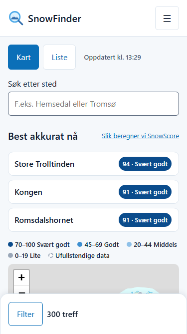
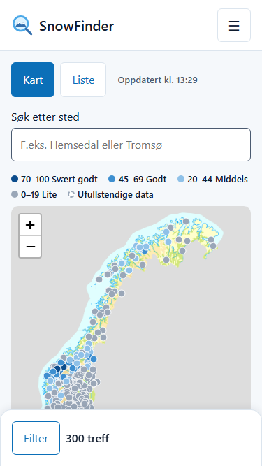
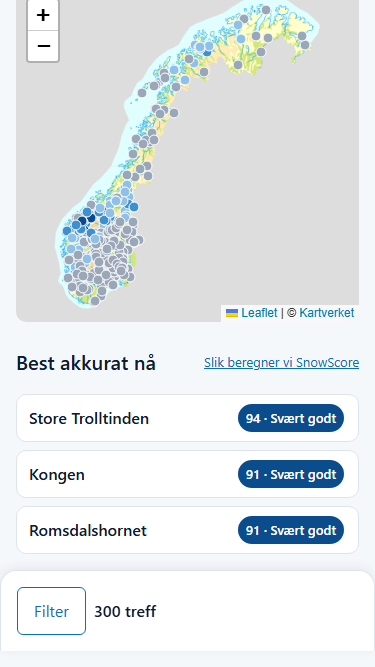

# Målinger av SM-1 og SM-12

Målt 2026-11-15 av Aksel med KI-assistanse (Claude Code), mot den publiserte nettsiden
<https://snowfinder-seven.vercel.app> med ekte data for 300 steder. Skriptet er
[`mal-ytelse.cjs`](mal-ytelse.cjs).

## Slik måles det

Måleskriptet styrer Chromium, som Playwright allerede installerer for E2E-testene. Hver kjøring
starter med tom hurtigbuffer.

Mobilprofilen er den samme som Lighthouse bruker for mobil:

- **Skjerm:** 412 × 823 med berøring.
- **Nett:** 4G med 150 ms forsinkelse, 1,6 Mbit/s ned og 750 kbit/s opp.
- **CPU:** fire ganger tregere enn maskinen. Det skal tilsvare en telefon i mellomsegmentet.

Målingene er tatt på en stasjonær Windows-PC. Hvor treg en «4× tregere» CPU blir, avhenger av
maskinen, så tallene er et anslag og ikke en måling på en ekte telefon.

- **SM-12 (NFR-2):**
  - Kartet regnes som interaktivt når Leaflet har tegnet markørene og et trykk på «Zoom inn»
    endrer zoomen. Kartflisene er ikke med.
  - Tiden måles fra navigeringen starter, over fem kjøringer.
- **SM-1 (NFR-1):**
  - Gjennomføres på den samme siden:
    - 80 steg med piltastene på de fem sliderne;
    - de to hurtigvalgene;
    - 32 tastetrykk i søkefeltet.
  - Event Timing-API-et i nettleseren måler hver endring, fra brukeren trykker til neste
    skjermbilde er tegnet. Det er samme mål som INP.
  - Filteret har ingen forsinkelse (debounce), så treffantallet og trefflisten er tegnet på nytt
    i det skjermbildet.
  - Endringer under 16 ms rapporteres ikke av nettleseren. De regnes som under 500 ms.

```sh
node "project-phase-folders/4-Avslutningsfasen/målinger/mal-ytelse.cjs"                  # mobilprofil (CPU 4×)
node "project-phase-folders/4-Avslutningsfasen/målinger/mal-ytelse.cjs" <url> 5 0        # bare 4G, rask CPU
```

## Resultat

| Profil | SM-12: kart interaktivt (krav < 3 s) | SM-1: endringer under 500 ms (krav 95 %) |
|---|---|---|
| 4G og CPU 4× (mobil i mellomsegmentet) | Median 9,0 s, verst 11,2 s. 0 av 5 under 3 s | 69 av 114 (61 %). Median 408 ms, p95 1320 ms, verst 2336 ms |
| 4G med rask CPU (PC eller rask telefon) | Median 2,7 s, verst 3,2 s. 4 av 5 under 3 s | 114 av 114 (100 %). Median 40 ms, p95 112 ms, verst 272 ms |

**Konklusjon:**

- På en rask enhet holder SM-1, og SM-12 holder nesten (4 av 5 kjøringer).
- På mobilprofilen holder ingen av dem. Begge målene er Må ha.

### Hvorfor mobilprofilen er treg

Funnene er fra ressurstidene og «long tasks» i nettleseren og fra koden.

**Kartlastingen går i serie:**

1. HTML og JavaScript lastes.
2. Appen starter og ber om `latest.json`.
3. Først da lastes Leaflet, som importeres inne i kartkomponenten.
4. Til slutt tegnes 300 SVG-markører.

Med 4G og rask CPU starter `latest.json` etter 1,3 s og Leaflet etter 1,7 s. På mobilprofilen
står hovedtråden opptatt i lange oppgaver på til sammen rundt 2,8 s.

**Hver filterendring tegner kartet på nytt:** `KartVisning.tsx` fjerner alle markørene og lager dem
på nytt som SVG med tooltip. Trefflisten tegnes også på nytt. Dette er en sannsynlig årsak, men den
er ikke profilert i detalj.

Mulige rettinger, som må bygges via `bmad-build`:

- hente `latest.json` og Leaflet parallelt med appen (`<link rel="preload">` / `modulepreload`);
- tegne markørene med canvas (`preferCanvas`), eller bare oppdatere de markørene som endres.

## Rådata

```text
URL: https://snowfinder-seven.vercel.app/  runs: 5  CPU slowdown: 4x  2026-11-15T17:06:57.194Z
SM-12 run 1: markers drawn and zoomable after 8989 ms (LCP 8992 ms, 300 markers, zoom ok)
SM-12 run 2: markers drawn and zoomable after 8470 ms (LCP 8480 ms, 300 markers, zoom ok)
SM-12 run 3: markers drawn and zoomable after 8146 ms (LCP 8160 ms, 300 markers, zoom ok)
SM-12 run 4: markers drawn and zoomable after 10384 ms (LCP 10392 ms, 300 markers, zoom ok)
SM-12 run 5: markers drawn and zoomable after 11156 ms (LCP 11176 ms, 300 markers, zoom ok)
SM-12: median 8989 ms, worst 11156 ms, under 3000 ms in 0/5
SM-1 changes made: {"slider":80,"hurtigvalg":2,"sok":32}; 114 in all, 117 of them took 16 ms or more
SM-1: p50 408 ms, p95 1320 ms, max 2336 ms, 45 of 114 changes at or over 500 ms (the rest under 16 ms count as under 500)

URL: https://snowfinder-seven.vercel.app/  runs: 5  CPU slowdown: none  2026-11-15T17:09:25.321Z
SM-12 run 1: markers drawn and zoomable after 3181 ms (LCP 2624 ms, 300 markers, zoom ok)
SM-12 run 2: markers drawn and zoomable after 2401 ms (LCP 1884 ms, 300 markers, zoom ok)
SM-12 run 3: markers drawn and zoomable after 2676 ms (LCP 2608 ms, 300 markers, zoom ok)
SM-12 run 4: markers drawn and zoomable after 2848 ms (LCP 3000 ms, 300 markers, zoom ok)
SM-12 run 5: markers drawn and zoomable after 2235 ms (LCP 1604 ms, 300 markers, zoom ok)
SM-12: median 2676 ms, worst 3181 ms, under 3000 ms in 4/5
SM-1 changes made: {"slider":80,"hurtigvalg":2,"sok":32}; 114 in all, 95 of them took 16 ms or more
SM-1: p50 40 ms, p95 112 ms, max 272 ms, 0 of 114 changes at or over 500 ms (the rest under 16 ms count as under 500)
```

«117 of them» er høyere enn 114 fordi trykket på Filter-knappen og Escape også blir målt. De to
regnes med i persentilene, så tallene er litt strengere enn de ellers ville vært.

En første prøvekjøring med mobilprofilen ga 14,5 s for kartet. Den var sannsynligvis kald
hurtigbuffer hos Vercel og GitHub og er ikke tatt med.

## Bør sjekkes

Mål på en ekte telefon i mellomsegmentet over 4G, for eksempel under brukertesten. Det avgjør om
mobilprofilen her er for streng eller treffer.

## Måling 20.11: kartet på små telefoner (løsning 1)

Målt 2026-11-20 av Aksel med KI-assistanse (Claude Code). Endringsforslaget er
[`sprint-change-proposal-2026-11-20-kart-sma-telefoner.md`](../../../project-workspace/planning-artifacts/sprint-change-proposal-2026-11-20-kart-sma-telefoner.md),
og spesifikasjonen er [`spec-fix-kart-sma-telefoner.md`](../../../project-workspace/implementation-artifacts/spec-fix-kart-sma-telefoner.md).

### Synlig kart på 375 × 667

Målt med [`mal-kart-synlig.cjs`](mal-kart-synlig.cjs): hvor mange px av kartet som er synlig over bunn-arket når
Utforsk åpnes, uten at brukeren ruller. `main` og løsning 1 er lokale produksjonsbygg med samme datafil (runId
`20261120T122900Z-5419dd89`, data fra 20.11 kl. 13.29 norsk tid). De er servert med gzip
([`serve-gzip.cjs`](serve-gzip.cjs)) og målt rett etter hverandre. Den publiserte siden ga også 59 px samme dag.

| | Kartet starter | Kartets høyde | Bunn-arket starter | **Synlig kart** | «Best akkurat nå» starter |
|---|---|---|---|---|---|
| Før (`main`) | 527 px | 467 px (70vh) | 586 px | **59 px** | 247 px |
| Etter (løsning 1) | 295 px | 334 px (50vh) | 586 px | **291 px** | 645 px |

- Kartet er lavere på mobil (50vh), fordi Leaflet setter `touch-action: none`. Et sveip på kartet ruller ikke siden.
  Med lavere kart er det alltid en stripe av siden over bunn-arket å sveipe på.
- Etter at siden er rullet 330 px, står hele raden over arket (338–554 px, og arket starter på 570 px).

| Før | Etter | Etter, rullet 330 px |
|---|---|---|
|  |  |  |

Kartflisene er grå på de lokale skjermbildene, fordi flisene ikke lastes der. På den publiserte siden vises de.

### SM-1 med løsning 1

Samme skript og profil som over (`mal-ytelse.cjs`, 4G og CPU 4×). Det er 10 runder, og variantene i hver serie er målt
etter tur.

| Serie | Variant | SM-1 samlet (krav 95 %) | Økter ≥ 95 % | Dårligste økt | p95, median |
|---|---|---|---|---|---|
| 1 | `main` | 92,0 % | 5 av 10 | 66,7 % | 512 ms |
| 1 | Løsning 1 | 92,8 % | 1 av 10 | 87,7 % | 572 ms |
| 2 | #124 (tiltak A) | 95,4 % | 6 av 10 | 89,5 % | 432 ms |
| 2 | #124 + løsning 1 (lokal fletting) | **96,3 %** | 6 av 10 | 92,1 % | 360 ms |

**Konklusjon:**
- Løsning 1 gjør ikke SM-1 dårligere. Sammen med #124 holder kravet.
- Alle tallene i serie 2 er lavere enn om morgenen, da #124 hadde 99,4 %. Maskinen var tregere om ettermiddagen:
  SM-12 var 7,8–8,4 s mot 5 s om morgenen. Variantene ble målt etter tur, så det påvirker begge likt.
- En første serie ble forkastet. To måleserier kjørte samtidig, og de forstyrret hverandre.

```text
Serie 1 (main mot løsning 1):
1 main 5468 312 1216 38 114 14:03:17
1 L1 5103 216 656 12 114 14:04:21
2 main 5616 208 528 7 114 14:05:26
2 L1 7082 216 624 14 114 14:06:32
3 main 5024 208 536 7 114 14:07:33
3 L1 5155 184 584 8 114 14:08:36
4 main 6452 208 552 7 114 14:09:42
4 L1 5080 208 552 9 114 14:10:44
5 main 4854 184 456 1 114 14:11:40
5 L1 5945 184 520 6 114 14:12:39
6 main 6763 184 496 5 114 14:13:39
6 L1 5802 184 560 9 114 14:14:39
7 main 6300 168 456 4 114 14:15:38
7 L1 5240 184 616 8 114 14:16:37
8 main 5307 184 480 5 114 14:17:36
8 L1 4389 200 552 6 114 14:18:36
9 main 5730 216 472 4 114 14:19:36
9 L1 4648 184 408 1 114 14:20:31
10 main 6046 176 776 13 114 14:21:33
10 L1 5573 224 656 9 114 14:22:37

Serie 2 (#124 mot #124 + løsning 1):
1 A124 6092 200 592 12 114 14:28:13
1 A124+L1 9492 80 368 2 114 14:29:09
2 A124 11594 72 376 1 114 14:30:07
2 A124+L1 5665 64 296 1 114 14:30:54
3 A124 7181 72 280 2 114 14:31:43
3 A124+L1 7387 64 280 3 114 14:32:33
4 A124 5936 88 432 4 114 14:33:34
4 A124+L1 6524 160 560 7 114 14:34:55
5 A124 8051 112 432 3 114 14:35:58
5 A124+L1 8242 104 304 3 114 14:36:56
6 A124 10717 104 392 2 114 14:38:03
6 A124+L1 12362 160 504 6 114 14:39:22
7 A124 12435 128 584 8 114 14:40:36
7 A124+L1 6989 120 640 7 114 14:41:50
8 A124 11481 120 632 8 114 14:43:05
8 A124+L1 6928 128 552 9 114 14:44:11
9 A124 8469 144 592 11 114 14:45:19
9 A124+L1 9655 120 352 2 114 14:46:24
10 A124 8369 112 352 1 114 14:47:25
10 A124+L1 8469 104 336 2 114 14:48:23
```
